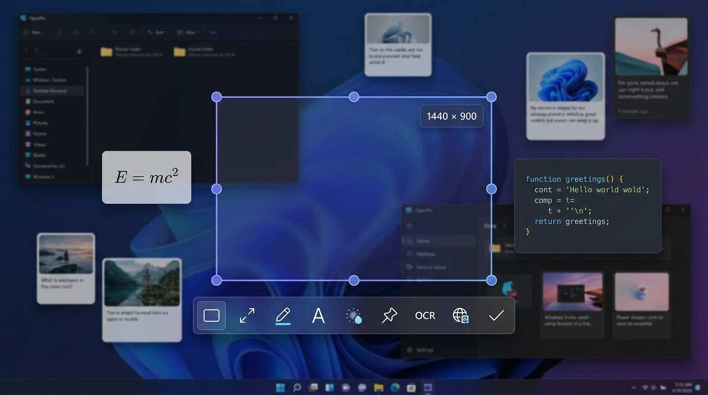
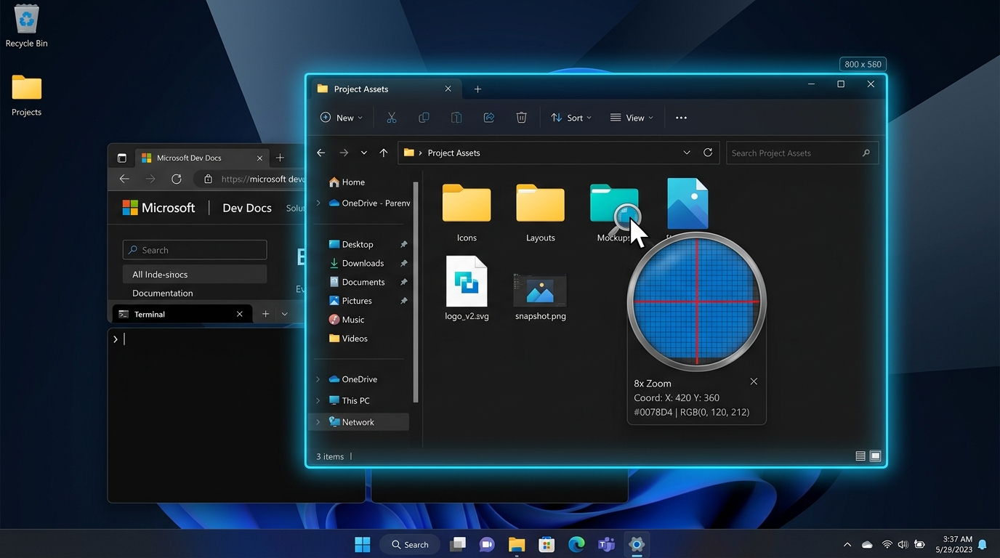
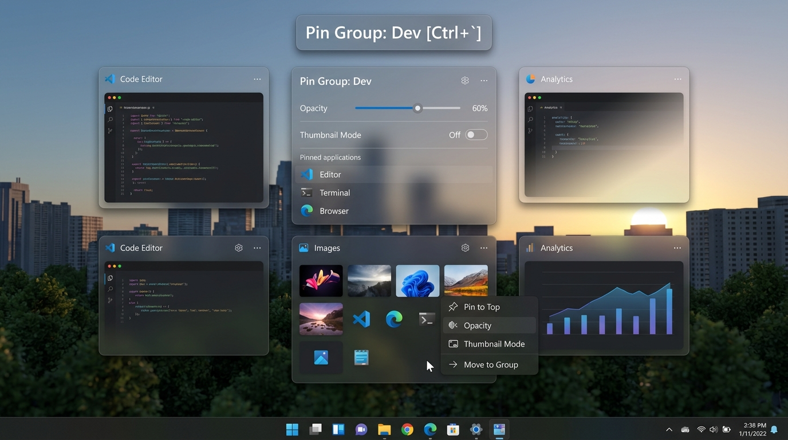
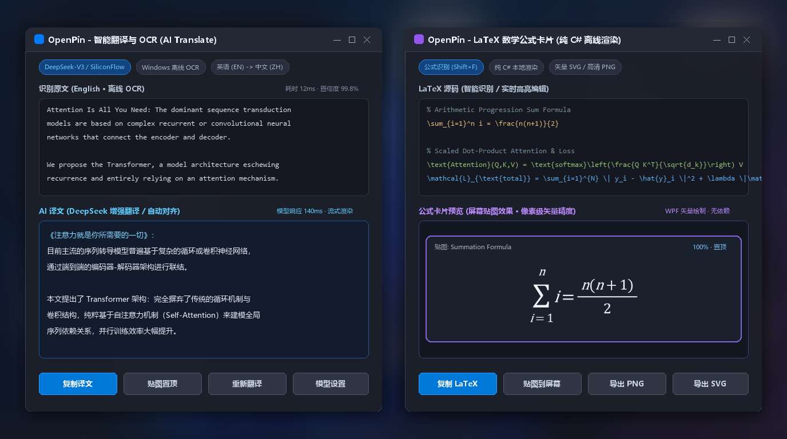

<p align="center">
  <a href="https://github.com/biubiu223/OpenPin">
    
  </a>
</p>

<h1 align="center">OpenPin</h1>

<p align="center">
  <strong>开源免费的 Windows 现代化截图、贴图与智能标注工具</strong><br/>
  <sub>A modern, privacy-first screenshot, screen pinning & annotation tool for Windows 10 &amp; 11</sub>
</p>

<p align="center">
  <a href="https://github.com/biubiu223/OpenPin/releases/tag/v0.1.1"></a>
  <a href="LICENSE"></a>
  
  
  <a href="https://github.com/biubiu223/OpenPin/stargazers"></a>
  <a href="https://github.com/biubiu223/OpenPin/issues"></a>
</p>

<p align="center">
  
</p>

---

## 💡 为什么选择 OpenPin？

**OpenPin** 是一款专为 Windows 10 / 11 设计的现代桌面截图工具。在汲取众多效率工具设计精髓的同时，坚持**真正开源、完全免费、隐私安全**的初心：

- 🛡️ **纯粹本地，隐私优先**：无账号体系、无云端上传、无任何遥测监控。所有截图数据、OCR 识别与配置文件均完整保存在本地。
- 🎨 **原生 Win11 Fluent 美学**：圆角设计、Mica / 亚克力半透明模糊特效、完整深色/浅色主题自适应与动态双语国际化（中/英）。
- 🚀 **极致性能与低资源占用**：基于 **.NET 10 (LTS)** 与原生 WPF / DirectX 硬件加速，冷启动秒开，4K 高分屏响应无卡顿。
- 🧩 **全能一体化生产力**：不仅是截图工具，更是集 **智能贴图**、**全能二次标注**、**离线 OCR**、**AI 大模型翻译**、**LaTeX 数学公式卡片**、**长截图**与**屏幕录制**于一体的工作流中枢。

---

## 🌟 核心特性展示

### 📸 智能截图与像素级放大镜
智能识别屏幕上的窗口边界与 UI 元素，鼠标悬停高亮，双击一键复制；内置高倍放大镜与网格辅助线，支持精确拾色。

<p align="center">
  
</p>

- **智能元素吸附**：精准抓取桌面顶层窗口、菜单与按钮范围，点击即可框选。
- **放大镜拾色器**：提供当前坐标、物理像素尺寸与网格预览，按 `C` 快速复制颜色，按 `Shift` 在 RGB / HEX / HSL / HSV 格式间循环切换。
- **键盘微调**：支持方向键及 `W/A/S/D` 像素级移动与缩放选区，`Shift+方向键` 收缩，`Ctrl+方向键` 扩展。
- **美化截图**：可选圆角截图、自定义阴影厚度与彩色边框，一键生成精美展示图。

---

### 📌 桌面自由贴图与贴图分组
将重要参考图、代码片段、文本或颜色常驻悬浮于屏幕最顶层，助你高效比对与多任务并行。

<p align="center">
  
</p>

- **丰富内容支持**：支持截图贴图、剪贴板图像、纯文本、文件图标与颜色色块直接贴图。
- **灵活操控体验**：滚轮缩放、`Ctrl+滚轮` 调节透明度、中键一键重置、支持鼠标穿透与半透明悬浮。
- **贴图快捷处理**：单键控制旋转（`1`/`2`）、水平/垂直翻转（`3`/`4`）、灰度黑白（`5`）、反色（`6`）与裁切。
- **多贴图组管理**：支持创建专属贴图组（如开发、设计、会议），使用 ``Ctrl+` `` 一键循环切换，按住 Ctrl 查看切换浮层。
- **状态持久化记忆**：程序重启后自动恢复屏幕上未关闭的贴图位置与配置。

---

### 🤖 离线 OCR、AI 智能翻译与 LaTeX 公式卡片
无需安装笨重插件，开箱即用的深度学习与公式推导利器。

<p align="center">
  
</p>

- **Windows 原生离线 OCR**：基于系统内置深度学习 OCR 引擎，毫秒级多语言文字提取，贴图上的文本更支持直接鼠标拖拽选中与复制。
- **AI 智能翻译（大模型多驱动）**：原生支持 OpenAI 兼容格式接口（**DeepSeek-V3 / R1**、**SiliconFlow 硅基流动**、Kimi、通义千问、本地 Ollama 等），亦支持百度与 DeepL 传统服务。
- **纯 C# 离线 LaTeX 渲染引擎**：截图一键识别数学公式（`Shift+F`），内置纯 C# 实现的 TeX 布局算法，无外部依赖直接渲染为高清公式贴图卡片，并支持导出矢量 SVG 与高清 PNG。

---

### ✏️ 全功能矢量标注与智能擦除
在选区或贴图上随时按下 `Space` 呼出标注工具栏，全套专业绘图套件随心使用。

| 标注工具 | 快捷键 | 功能亮点 |
|---|---|---|
| **矩形 / 椭圆** | `Shift+1` | 支持线型（实/虚/点）、填充模式、圆角调整，按住 Shift 保持正方形/正圆 |
| **直线 / 折线** | `Shift+2` | 支持单向/双向箭头样式，按住 Shift 自动进行 45° 角度吸附 |
| **箭头标注** | `Shift+3` | 实心渐细箭头与线条箭头，拖动端点可二次微调，双击直接添加注释文本 |
| **数字序号** | `Shift+4` | 自动递增标记（数字 / 字母 / 罗马数字），拖拽可生成连线引出指示 |
| **画笔与荧光笔** | `Shift+5` / `6` | 自由笔迹防抖平滑处理；荧光笔支持矩形与笔刷，自带正片叠底半透明混合 |
| **马赛克 / 智能擦除** | `Shift+7` | 传统马赛克/高斯模糊，以及基于边界的**智能擦除**（离线自然补全去水印） |
| **富文本注释** | `Shift+8` | 系统字体选择、字号滚轮缩放、描边阴影、圆角背景色，支持随时双击重编 |
| **橡皮擦 / 撤销** | `Shift+9` / `Ctrl+Z` | 笔刷与框选擦除，图元级无损历史记录，随时撤销与重做 |

---

### 🎞️ 长截图滚动拼接与高清屏幕录制
- **长截图（Scrolling Capture）**：进入长截图模式后通过鼠标滚轮或自动平滑滚动，智能特征重叠匹配拼接，支持反向滚动自动裁剪多余区域。
- **屏幕录制（Screen Recording）**：支持导出高质量 GIF 与 MP4（H.264 硬件编码），可显示鼠标点击涟漪动画、按键实时回显，支持系统声音录制与摄像头画中画。

---

## ⌨️ 常用快捷键速查

> 💡 *所有快捷键均可在「设置」界面中根据个人习惯自由修改。*

### 全局动作
| 动作 | 默认快捷键 | 说明 |
|---|---|---|
| **截图** | `Ctrl + 1` | 冻结屏幕，进入智能选区与标注界面 |
| **贴图** | `Ctrl + 2` | 将剪贴板图像、文本、颜色或文件直接贴在屏幕上 |
| **恢复贴图** | `Ctrl + 3` | 从关闭历史中依序重新恢复贴图 |
| **自定义 / 延时截图** | `Alt + 1` | 弹出预设尺寸与定时倒计时截图对话框 |
| **切换贴图组** | `` Ctrl + ` `` | 循环切换不同工作贴图组 |

### 截图选区界面
| 按键 | 功能说明 |
|---|---|
| `鼠标左键拖拽` | 创建选区，双击直接复制当前窗口并退出 |
| `鼠标右键` | 有选区时清除选区，无选区时退出截图 |
| `方向键` / `W A S D` | 像素级平移当前选区位置（配合放大镜） |
| `Shift + 方向键` | 选区对应边向内收缩 1 像素 |
| `Ctrl + 方向键` | 选区对应边向外扩展 1 像素 |
| `C` / `Shift` | 放大镜中复制颜色值 / 切换色彩格式（HEX / RGB / HSL） |
| `Ctrl + C` / `Enter` | 复制截图到剪贴板 |
| `Ctrl + S` / `Ctrl + Shift + S` | 保存截图文件 / 快速保存到预设目录 |
| `Ctrl + T` | 将当前截图直接转为桌面置顶贴图 |
| `Shift + C` | 快速识别选区内文字并复制到剪贴板 |
| `Ctrl + Q` | 呼出 AI 智能翻译面板 |
| `Shift + F` | 识别选区内的数学公式并生成 LaTeX 卡片 |
| `Esc` | 退出截图 |

### 桌面贴图操作
| 按键 | 功能说明 |
|---|---|
| `鼠标滚轮` | 缩放贴图（以鼠标所在点或中心为锚点） |
| `Ctrl + 鼠标滚轮` | 调节贴图不透明度（10% ~ 100%） |
| `鼠标中键单击` | 重置贴图大小与透明度为 100%，再次点击还原 |
| `Space (空格)` | 展开 / 收起贴图专属标注工具栏 |
| `L` / `T` | 锁定贴图位置 / 切换是否总在最前 |
| `R` | 切换缩略图模式（仅显示局部内容） |
| `1` / `2` / `3` / `4` | 向右旋转 / 向左旋转 / 水平翻转 / 垂直翻转 |
| `5` / `6` | 灰度滤镜 / 反色滤镜 |
| `Ctrl + W` / `Esc` / 双击 | 关闭贴图（存入历史，可用 `Ctrl+3` 随时恢复） |
| `Ctrl + D` | 彻底销毁贴图（不进历史） |

---

## 📦 下载与安装

进入项目的 [**GitHub Releases**](https://github.com/biubiu223/OpenPin/releases) 页面获取最新发布的正式安装包：

| 下载版本 | 文件名 | 适用场景 |
|---|---|---|
| 🌟 **标准安装包（推荐）** | `OpenPin-0.1.1-Setup-x64.exe` | 完整集成运行环境，安装向导一键配置桌面快捷方式与开机自启 |
| 🚀 **绿色免安装便携版** | `OpenPin-0.1.1-win-x64-Portable.zip` | 解压即用，配置与贴图保存在自带 `data/` 目录，随身 U 盘首选 |
| 🪶 **轻量依赖版** | `OpenPin-0.1.1-win-x64-framework-dependent.zip` | 极小体积包，需系统中预装 [.NET 10 桌面运行时](https://dotnet.microsoft.com/download/dotnet/10.0) |
| 🏬 **MSIX 应用包** | `OpenPin-0.1.1-win-x64.msix` | 支持 Windows App 管理体系与纯净隔离沙箱 |

> [!NOTE]
> **便携模式说明**：在任意解压版 `OpenPin.exe` 同目录下放置名为 `portable` 的空文件，OpenPin 将自动切换为便携模式，不再读写系统 `%AppData%`。详细发布与打包文档见 [docs/PACKAGING.md](docs/PACKAGING.md)。

---

## 🛠️ 从源码构建

OpenPin 基于最新的 **.NET 10** 与 C# 13 构建。

### 环境准备
- **操作系统**：Windows 10 1809 (Build 17763) 或更新版本 / Windows 11 (x64)
- **开发工具**：[.NET 10 SDK](https://dotnet.microsoft.com/download/dotnet/10.0) 与 Visual Studio 2026 / JetBrains Rider / VS Code

### 本地编译运行
```bash
# 1. 克隆代码仓库
git clone https://github.com/biubiu223/OpenPin.git
cd OpenPin

# 2. 运行完整单元测试套件（770+ 项测试用例全部绿灯）
dotnet test

# 3. 编译并启动主程序
dotnet run --project src/OpenPin
```

### 独立发布打包
```powershell
# 编译并生成自包含单文件便携包与 Inno Setup 安装程序
./packaging/build-installer.ps1 -Version 0.1.1
```

---

## 🗺️ 项目技术架构

详细架构设计与代码分层请参阅：
- [docs/SPEC.md](docs/SPEC.md) — 完整功能规格说明书与设计细则
- [docs/ARCHITECTURE.md](docs/ARCHITECTURE.md) — 核心事件驱动总线、标注渲染管线与设计模式
- [docs/PACKAGING.md](docs/PACKAGING.md) — CI/CD 自动化构建、MSIX 打包与发布规范
- [CHANGELOG.md](CHANGELOG.md) — 版本更新日志与迭代历史记录

```
OpenPin/
├── src/OpenPin/
│   ├── Capture/       # 全屏冻结抓取、窗口自动化识别、放大镜与选区微调
│   ├── Annotation/    # 矢量图元引擎、二次编辑控制手柄、智能修复与调色板
│   ├── Pin/           # 独立贴图窗口、贴图组管理、图像处理与历史恢复
│   ├── Recognition/   # 离线 OCR、表格提取、纯 C# LaTeX 公式解析与渲染引擎
│   ├── Translate/     # AI 多大模型（DeepSeek/OpenAI兼容）及翻译适配器
│   ├── LongCapture/   # 智能特征对齐纵向与横向长截图滚动拼接
│   ├── Recording/     # 硬件加速录屏（GIF/MP4）、点击水波纹与按键可视化
│   ├── Services/      # 剪贴板调度、模板化保存器、通知浮窗与快捷键中心
│   └── SettingsUI/    # Win11 Mica 材质与 NavigationView 现代设置面板
└── tests/OpenPin.Tests/ # 覆盖核心服务、算法与渲染器的全量单元测试
```

---

## 🤝 参与贡献

欢迎通过提交 Issue、报告 Bug 或发起 Pull Request 共同改进 OpenPin！在提交代码前，请先阅读 [CONTRIBUTING.md](CONTRIBUTING.md)。

### 第三方开源致谢
- [Hardcodet.NotifyIcon.Wpf](https://github.com/hardcodet/wpf-notifyicon) (MIT) — 优雅的 WPF 系统托盘与上下文菜单
- [ZXing.Net](https://github.com/micjahn/ZXing.Net) (Apache-2.0) — 高效的多码合一识别库

---

## 📄 开源许可证

本项目基于 [MIT License](LICENSE) 授权，永久开源免费，个人与商业均可自由使用。

<p align="center">
  <sub>Made with ❤️ by OpenPin Contributors. Open source and free forever.</sub>
</p>
